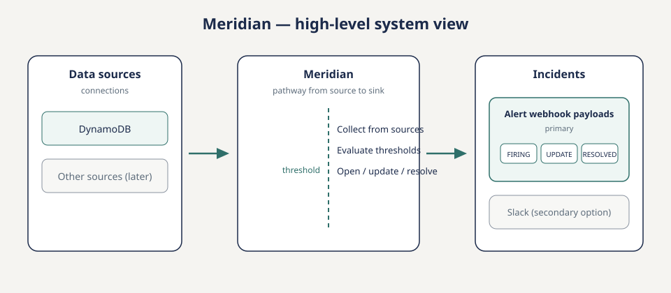
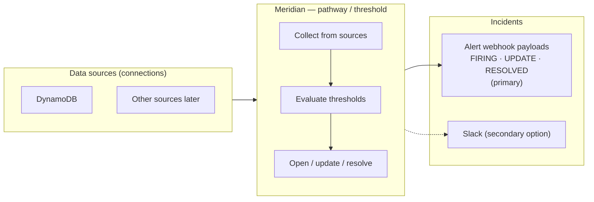

# Meridian — high-level system view

Matches the public framing in the root [README](../../../README.md): sources on one end, incidents on the other; alert webhook payloads as the primary output; Slack secondary. No timeseries jargon in the consumer story.

## Same view (Mermaid)

## Why this shape

- **Left:** connections attach Meridian to data sources.
- **Center:** Meridian is the pathway and the reference line (threshold between quiet and page). Collect, evaluate, then open / update / resolve — not every reading becomes an incident.
- **Right:** primary sink is the **alert webhook payload**; Slack is an optional secondary notify path.
