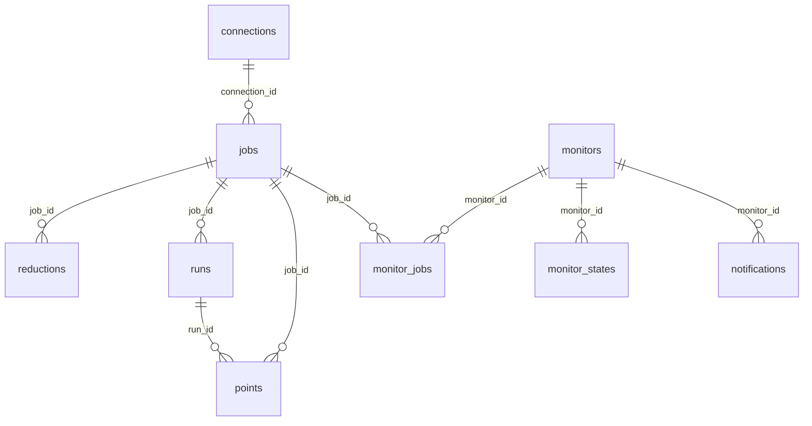

# Data model

This is the as-built persistence model for Meridian: what is stored, how tables relate, and the JSON shapes that matter at the edges. Product words (metric, series, window) are defined in [`terminology.md`](./terminology.md). Runtime wiring lives in [`implementation/as-built.md`](./implementation/as-built.md). Operator SQL: [`../how-to/config-sql.md`](../how-to/config-sql.md) and [`../how-to/points-timeseries.md`](../how-to/points-timeseries.md).

## Source of truth

| Layer | Location |
|---|---|
| Drizzle schema (types + constraints) | [`src/db/schema.ts`](../../src/db/schema.ts) |
| Dynamic tag shapes | [`src/db/dynamic-tags.ts`](../../src/db/dynamic-tags.ts) |
| Severity config shapes | [`src/db/severity.ts`](../../src/db/severity.ts) |
| Tag normalization | [`src/db/tags.ts`](../../src/db/tags.ts) |
| SQL migrations | [`drizzle/`](../../drizzle/) |
| Store / CRUD | [`src/db/store.ts`](../../src/db/store.ts) |

Local database: TimescaleDB via Compose (`docker-compose.yml`, port **5433**, volume `p2v3-pg`). Apply migrations with `npm run db:migrate`.

## Entity overview



| Plane | Tables | Role |
|---|---|---|
| **Config** | `connections`, `jobs`, `reductions`, `monitors`, `monitor_jobs` | What to collect and what to page |
| **Runtime / history** | `runs`, `points`, `monitor_states`, `notifications` | What happened and what is open |

There is no separate metrics database and no single `config` table. `connections.config` is a JSONB column, not a table.

## Conceptual objects (not tables)

| Concept | How it appears in storage |
|---|---|
| **Metric** | `reductions.metric_name` / `points.metric_name` / `monitors.metric_name` — one named number; aggregation is baked into the name (e.g. `row_count`, `reading_mean`). |
| **Series** | One `job_id` + one `metric_name` + one exact `tags` map. Two jobs never share a series. |
| **Identity vs condition tags** | Dynamic tag `absent`: `omit` = identity; `zero` = condition (synthetic 0 on successful runs when missing). ADR-002. |
| **Collection window** | Recorded on `runs` (`window_start`, `window_end`). Successful points are stamped at **window end**, not at each source event time. |
| **Monitor incident (identity)** | `monitor_states` row whose `series_key` is an incident key (condition tags stripped). ADR-007. |

## Tables

### `connections`

Source credentials and non-secret connection settings.

| Column | Type | Notes |
|---|---|---|
| `id` | uuid PK | |
| `name` | text | Unique |
| `source_type` | text | Today: `dynamodb` |
| `secret_ref` | text | Opaque label / handle for the secret |
| `secret` | text | Live credential material (sensitive) |
| `config` | jsonb | Source-specific settings; default `{}` |
| `created_at` | timestamptz | |

**FK:** none inbound required. Jobs reference `connections.id` with **ON DELETE no action** (cannot drop a connection that still has jobs without handling jobs first).

**`config` for DynamoDB** (as written by the connection form):

```json
{
  "tableName": "…",
  "region": "us-east-1",
  "endpoint": "http://localhost:8000"
}
```

`endpoint` is optional (local DynamoDB). Access key material lives in `secret`, not in `config`.

---

### `jobs`

Collection job definition.

| Column | Type | Notes |
|---|---|---|
| `id` | uuid PK | |
| `name` | text | Display name; not unique |
| `connection_id` | uuid FK → `connections` | |
| `enabled` | boolean | Default true; disabled jobs are not due |
| `health` | text | `ok` \| `failing` (updated after runs) |
| `query` | jsonb | Source query; see below |
| `window_mode` | text | `since_last_run` \| `fixed_lookback` \| `calendar` |
| `max_lookback_seconds` | int | Positive; meaning depends on window mode |
| `interval_seconds` | int | Positive; used when not on cron |
| `cron` | text | Empty string = interval schedule |
| `static_tags` | jsonb | `Record<string, string>`; merged onto every point at write |
| `dynamic_tags` | jsonb | `DynamicTag[]`; see below |
| `created_at` | timestamptz | |

**Checks:** window mode enum; lookback and interval &gt; 0; health enum.

**`query` (DynamoDB today):**

```json
{ "text": "pk=UPS-01 AND status=FAULTED" }
```

Legacy / alternate: `{ "partitionKey": "…" }` may still appear in older rows; the UI and store prefer `text`.

**App-level uniqueness (not a DB unique constraint):** two jobs must not write the same `metric_name` with the same `static_tags`. Enforced in `store.ts` on create/update.

---

### `reductions`

Named numbers a job produces per series each successful run.

| Column | Type | Notes |
|---|---|---|
| `id` | uuid PK | |
| `job_id` | uuid FK → `jobs` | **ON DELETE cascade** |
| `position` | int | Order in the job; ≥ 0; unique per job |
| `aggregation` | text | `count` \| `sum` \| `mean` \| `min` \| `max` \| `p95` \| `distinct_count` |
| `metric_name` | text | Unique per job |
| `field` | text nullable | Required for all aggregations except `count` |
| `filter` | jsonb nullable | Optional row filter for the reduction |

Metric names are derived in app code (`metricNameFor`): `count` → `row_count`; otherwise `{field}_{aggregation}`.

---

### `runs`

One attempt to collect a window for a job.

| Column | Type | Notes |
|---|---|---|
| `id` | uuid PK | |
| `job_id` | uuid FK → `jobs` | **ON DELETE cascade** |
| `window_start` | timestamptz | |
| `window_end` | timestamptz | Must be &gt; `window_start` |
| `status` | text | `running` \| `success` \| `failed` |
| `error` | text nullable | Failure message |
| `created_at` | timestamptz | |

Failed runs write **no** points. Successful runs create points with `run_id` set and `time = window_end`.

---

### `points`

TimescaleDB **hypertable** on `time`. App-owned time series.

| Column | Type | Notes |
|---|---|---|
| `time` | timestamptz | Partition key; PK part |
| `job_id` | uuid | PK part; **no FK** in schema (orphan points possible if a job is deleted) |
| `metric_name` | text | PK part |
| `tags` | jsonb | PK part; normalized `Record<string, string>` |
| `value` | double | |
| `run_id` | uuid nullable | Soft link to `runs.id` |

**Primary key:** `(time, job_id, metric_name, tags)`.

Tag merge at write: `normalizeTags({ ...point.tags, ...job.staticTags })` — static tags win on key collision.

Created in migration `0000` via `create_hypertable('points', 'time')`.

---

### `monitors`

Threshold paging definition. Selects a metric name and optional tag filter across one or more jobs.

| Column | Type | Notes |
|---|---|---|
| `id` | uuid PK | |
| `name` | text | |
| `metric_name` | text | Must match points the linked jobs write |
| `tag_filter` | jsonb | `TagFilter` = `Record<string, string[]>` (OR within key, AND across keys) |
| `threshold` | double | Alert when value ≥ threshold for N consecutive points |
| `severity` | jsonb | `SeverityConfig`; see below |
| `team` | text | Shown on pages |
| `manual_url` | text | Optional runbook URL |
| `notify_mode` | text | `slack` \| `webhook` (exclusive sinks) |
| `slack_webhook` | text | Used when `notify_mode = slack` |
| `alert_webhook` | text | Used when `notify_mode = webhook` (C3) |
| `consecutive_points` | int | &gt; 0; streak length before fire |
| `created_at` | timestamptz | |

Monitors no longer store a single `job_id`; membership is `monitor_jobs` (migration `0005`).

---

### `monitor_jobs`

Many-to-many: which jobs a monitor evaluates.

| Column | Type | Notes |
|---|---|---|
| `monitor_id` | uuid FK → `monitors` | **ON DELETE cascade** |
| `job_id` | uuid FK → `jobs` | **ON DELETE cascade** |

**PK:** `(monitor_id, job_id)`.

---

### `monitor_states`

Per-monitor series / incident status. Written by evaluation after successful point writes.

| Column | Type | Notes |
|---|---|---|
| `monitor_id` | uuid FK → `monitors` | **ON DELETE cascade** |
| `series_key` | text | Opaque string key; see Series keys |
| `tags` | jsonb | Tags associated with the state row (driving / identity) |
| `status` | text | `ok` \| `alert` |
| `value` | double | Last evaluated value |
| `alert_opened_at` | timestamptz nullable | When this row entered alert; C3 `fired_at` through resolve |
| `page_severity` | text nullable | Last notified page severity (`critical` / `warning` / `info`) |
| `updated_at` | timestamptz | |

**PK:** `(monitor_id, series_key)`.

---

### `notifications`

Append-only page history (Slack or webhook transitions recorded after send path).

| Column | Type | Notes |
|---|---|---|
| `id` | uuid PK | |
| `monitor_id` | uuid FK → `monitors` | **ON DELETE cascade** |
| `tags` | jsonb | Tags on the transition |
| `transition` | text | `firing` \| `resolved` |
| `value` | double | |
| `created_at` | timestamptz | |

Severity updates on an open identity incident may refresh the sink without always inserting a new row; see ADR-007 and monitor evaluation.

## JSON shapes in detail

### Dynamic tags (`jobs.dynamic_tags`)

Discriminated union (`DynamicTag`):

**Field tag**

```json
{ "type": "field", "name": "asset_id", "absent": "omit" }
```

**Path tag**

```json
{
  "type": "path",
  "tag": "alarm_severity",
  "path": "alarms[*].severity",
  "pick": "priority",
  "priority": ["error", "warning", "info"],
  "whenEmpty": "warning",
  "absent": "zero"
}
```

| Field | Meaning |
|---|---|
| `absent: "omit"` | **Identity** — no invented point when missing |
| `absent: "zero"` | **Condition** — after a successful run, prior/open series with this tag that were not written get value `0` |
| `pick` | `first` \| `last` \| `priority` |
| `whenEmpty` | Literal string, or `null` to omit the tag when the path finds nothing |

Legacy string entries in the array are normalized to field tags with `absent: "omit"`.

### Severity (`monitors.severity`)

```ts
| { mode: "unset" }
| { mode: "fixed"; fixed: "critical" | "warning" | "info" }
| {
    mode: "from_tag";
    tag: string;
    map: Record<string, "critical" | "warning" | "info">;
    whenMissing: "omit" | "fixed";
    fixed?: "critical" | "warning" | "info";
  }
```

Page severity is resolved at notify time. Stored `page_severity` on `monitor_states` remembers what was last sent for identity incidents.

### Tag filter (`monitors.tag_filter`)

```json
{ "hall_id": ["HALL-01"], "status": ["FAULTED"] }
```

Each key maps to an allowed list of values. Empty object = no tag filter (all series for the metric on linked jobs).

### Static / point tags

Always `Record<string, string>` after `normalizeTags` (trimmed keys/values, stable ordering for comparisons where required). JSONB equality is used for exact-series point lookups.

## Series keys (`monitor_states.series_key`)

Produced in [`src/monitor/message.ts`](../../src/monitor/message.ts):

| Kind | Form | Use |
|---|---|---|
| Full series | `JSON.stringify({ jobId, tags })` | Per exact tag set (threshold / consecutive evaluation) |
| Identity incident | `JSON.stringify({ jobId, incident: identityTags })` | Open incident across condition-tag changes; severity updates |

`isIncidentSeriesKey` detects the `incident` property. Condition tag keys are those with `absent === "zero"` on the job’s dynamic tags.

## Cascade and orphan behavior

| Delete | Cascades to | Does not cascade to |
|---|---|---|
| `connections` | — (blocked if jobs remain) | |
| `jobs` | `reductions`, `runs`, `monitor_jobs` | **`points`** (no FK) |
| `monitors` | `monitor_jobs`, `monitor_states`, `notifications` | |

Deleting a job therefore can leave orphan `points` rows. Targeted point cleanup is SQL; see the points how-to. Full volume wipe: `docker compose down -v`.

## Migration timeline

| Migration | What it added |
|---|---|
| `0000_m1_schema` | `connections`, `jobs`, `reductions`, `runs`, `points` hypertable |
| `0001_connection_secret` | Live `secret` on connections |
| `0002_job_health` | `jobs.health` |
| `0003_monitors` | `monitors`, `monitor_states`, `notifications` (monitors had single `job_id`) |
| `0004_m6_job_monitor_surface` | Job surface fields; `consecutive_points` |
| `0005_monitor_jobs` | M:N jobs; drop `monitors.job_id`; tag filter → string arrays |
| `0006_monitor_severity_config` | Severity JSON config |
| `0007_monitor_state_alert_opened_at` | `alert_opened_at` |
| `0008_monitor_notify_mode` | Exclusive Slack vs alert webhook |
| `0009_monitor_state_page_severity` | `page_severity` for identity severity updates |

## Related decisions

| Doc | Topic |
|---|---|
| [ADR-001](../adr/001-generic-path-dynamic-tags.md) | Path dynamic tags |
| [ADR-002](../adr/002-identity-vs-condition-dynamic-tags.md) | Identity vs condition (`absent`) |
| [ADR-003](../adr/003-monitor-page-severity.md) | Page severity |
| [ADR-006](../adr/006-exclusive-notify-sinks.md) | Slack vs webhook |
| [ADR-007](../adr/007-identity-alert-key-severity-updates.md) | Identity alert key + severity updates |
| [`../inspection-notes.md`](../inspection-notes.md) | Evaluation semantics (windows, consecutive points) |
