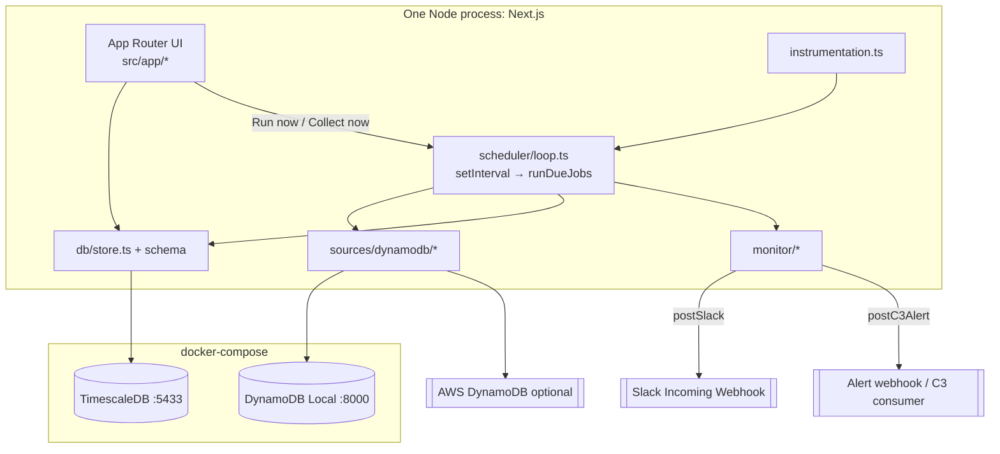
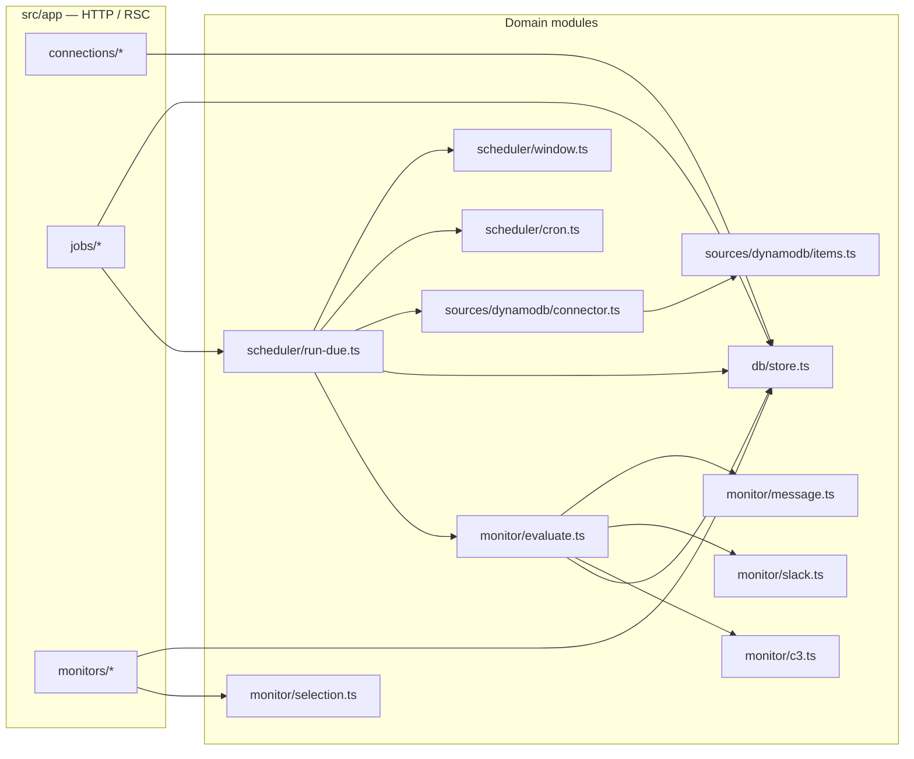
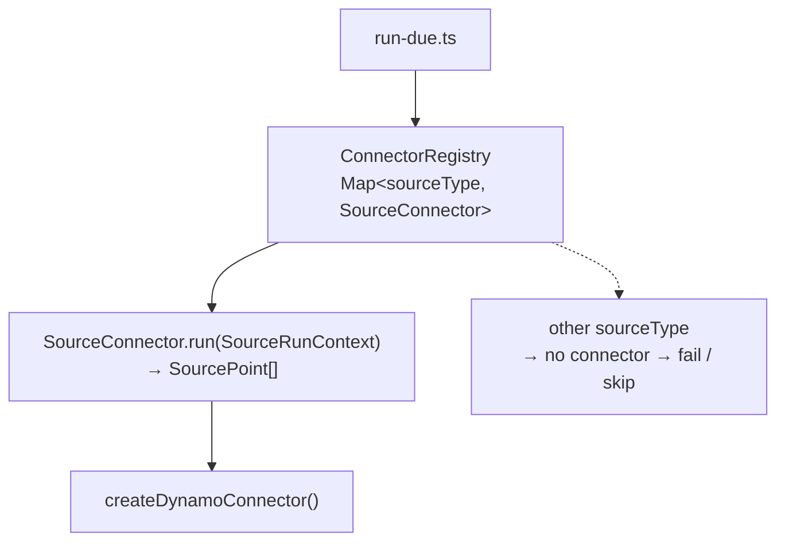
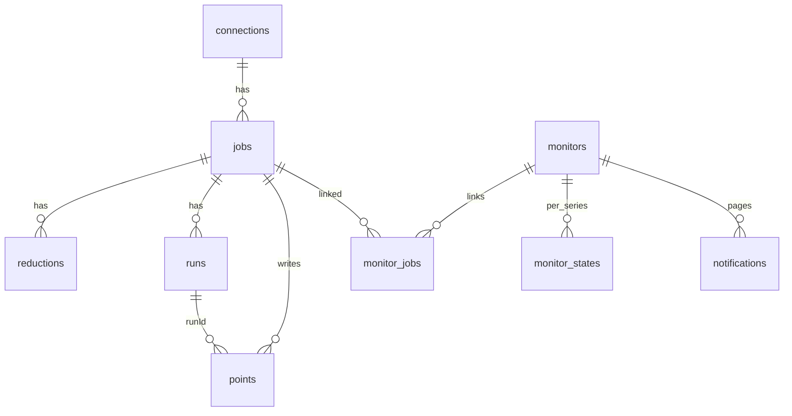
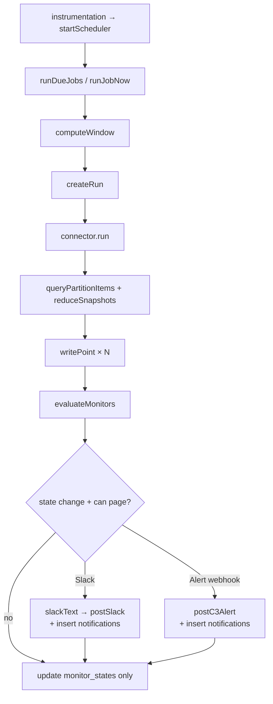
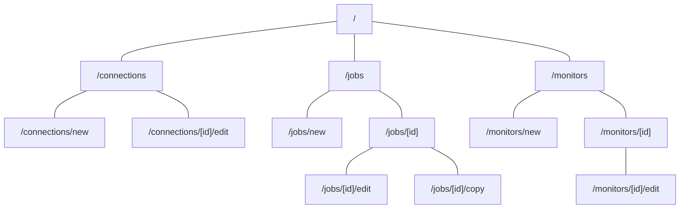

# As-built implementation

What exists in the codebase today (through alert-webhook / C3 emit). Consumer-facing shape: [`../conceptual/meridian-high-level-system-view.md`](../conceptual/meridian-high-level-system-view.md).

For product words (metric, series, window), see [`../terminology.md`](../terminology.md).

## 1. Process and system boundaries

Everything runs in-process with the Next server. No separate worker, queue, or metrics DB.

## 2. Module map (`src/`)

| Area | Role |
|------|------|
| `src/app/*` | Pages, forms, server actions |
| `src/db/*` | Schema, Drizzle client, CRUD |
| `src/scheduler/*` | Due ticks, windows, cron, retries |
| `src/sources/dynamodb/*` | Only connector implementation |
| `src/monitor/*` | Evaluate series, Slack text, C3 alert webhook, job-picker helpers |

## 3. Connector boundary

`scheduler/source.ts` defines the contract. Today only `"dynamodb"` is registered (from `loop.ts` and tests).

## 4. Persistence

Full table/column/JSON reference: [`../data-model.md`](../data-model.md).

Config: `connections`, `jobs`, `reductions`, `monitors`, `monitor_jobs`  
Runtime: `runs`, `points`, `monitor_states`, `notifications`

Migrations live under `drizzle/`. Local DB is `docker-compose.yml` (TimescaleDB + DynamoDB Local).

## 5. Runtime call chain (one successful collect)

## 6. UI routes

Manual triggers: job **Run now** (`jobs/run-now-action.ts` → `runJobNow`); monitors can trigger collect through the same scheduler path.

## 7. Inside vs outside

| Inside the Next process | Outside |
|-------------------------|---------|
| App Router UI + server actions | Browser |
| In-process scheduler loop | — |
| Drizzle / `store` | TimescaleDB container |
| DynamoDB connector | DynamoDB Local or AWS |
| `postSlack` HTTP client | Slack incoming webhook URL (Slack notify mode) |
| `postC3Alert` HTTP client | Monitor alert-webhook URL (C3 **0.3** POST); optional `P8_ALERT_URL` only prefills the default on new monitors |
| Vitest against real DB | — |

Not built: separate worker, undelivered-alert board, non-Dynamo connectors, email, multi-tenant auth.
